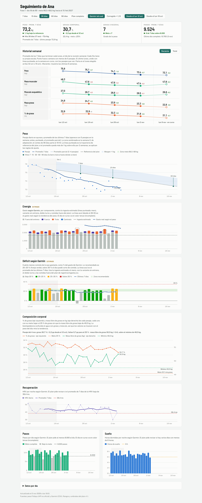
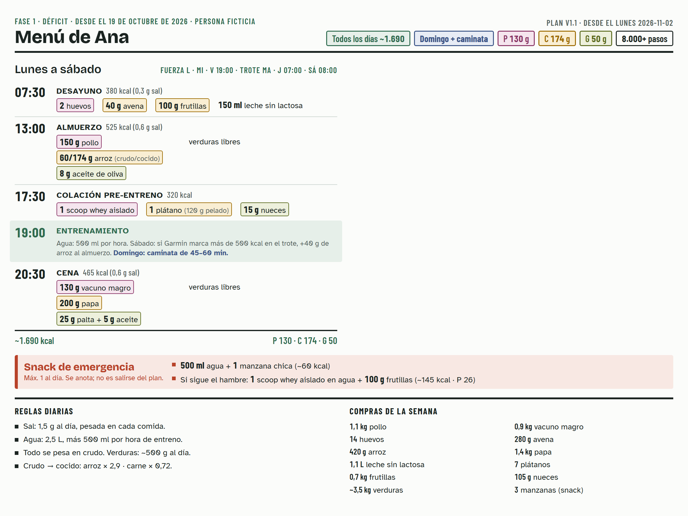

# Alimentación

Plan de alimentación con seguimiento diario, operado por un agente de código (Claude Code u otro que lea `AGENTS.md`). El agente hace de nutricionista deportivo: arma un plan para bajar grasa sin perder músculo, lee cada día la pesa y el reloj, lleva los registros, genera un panel local y ajusta el plan solo con reglas explícitas.

> **No reemplaza a un médico ni a un nutricionista.** Antes de armar un déficit, el agente pregunta por condiciones y medicamentos, y deriva al médico cuando corresponde (`crear-plan.md`).

## Con qué dispositivos funciona
Se diseñó con tres dispositivos, pero **ninguno es obligatorio**: cada uno se puede cambiar por otro.

| Qué mide | Con qué se diseñó | Se puede cambiar por |
|---|---|---|
| Actividad, sueño, HRV y gasto | WHOOP | Garmin, Apple Watch, Fitbit (incluido el Fitbit Air), Oura, Polar, Samsung Galaxy Watch… o nada |
| Peso y composición corporal | Pesa Fitdays (bioimpedancia, **experimental**) | Otra pesa inteligente (Withings, Renpho, Eufy, Xiaomi, Garmin Index…), una InBody o una pesa común con el peso anotado a mano |
| Presión arterial (opcional) | Tensiómetro Withings | Omron u otro tensiómetro, o las tomas anotadas a mano |

- **Con los tres originales**, los datos se sincronizan solos cada mañana.
- **Con otro dispositivo**, exportas los datos desde su app (un CSV o el archivo que entregue, como el XML de Apple Salud) y los dejas en una carpeta. La primera vez, el agente escribe un conversor y desde ahí lo reutiliza (ver «Otros dispositivos», abajo).
- **Lo que tu dispositivo no mida, no aparece.** Si no tienes la recovery de WHOOP o los segmentos de la pesa, el panel oculta esas secciones y el plan no usa las reglas que dependen de ellas. Lo único indispensable es el peso.
- Cada dispositivo mide distinto el gasto, la HRV y el sueño. El agente los calibra con tus propios datos y no copia los valores de otro dispositivo ni de otra persona.

## Qué hay
| Archivo | Para qué |
|---|---|
| `AGENTS.md` | Cómo opera el agente: rutina diaria, revisión semanal, técnico. `CLAUDE.md` solo lo importa |
| `metodologia.md` | Con qué criterio se diseña, se sigue y se ajusta el plan |
| `crear-plan.md` | Cómo armar el plan de una persona nueva, empezando por el filtro de seguridad |
| `formatos.md` | Columnas de los CSV, para cargar datos a mano o de otro dispositivo |
| `plantillas/` | Punto de partida de los archivos de `persona/` |
| `ejemplo/` | Una persona ficticia con todo armado (datos inventados) |
| `visualizacion/` | Generador y plantilla del panel |
| `persona/` | **Todo lo tuyo** (perfil, plan, registros, panel). No existe al principio y nunca se comparte |

## El ejemplo: Ana
`ejemplo/` es una persona ficticia, con datos inventados, armada de principio a fin con `crear-plan.md`. Ana tiene 38 años, es intolerante a la lactosa, hace fuerza 3 veces por semana y trota. Usa una pesa Fitdays y un **Garmin** en vez de WHOOP, así que también muestra cómo se usa otro dispositivo.

| Archivo | Qué muestra |
|---|---|
| `perfil.md`, `operacion.md` | Quién es, sus reglas médicas y sus fechas de revisión |
| `plan/` | El plan con cálculos, menú, pesos de referencia, hitos y reglas de ajuste |
| `registros/` | Las primeras semanas: registro diario, seguimiento, pesajes, actividad e ingesta |
| `analisis/gasto-calorico.md` | La recalibración del gasto a las 2 semanas |
| `entrada/` e `importar/` | Una exportación de Garmin y el conversor que la pasa al formato estándar |
| `panel.html`, `imprimir/` | El panel y el menú del refrigerador (abajo) |

### Panel
Lo genera el agente cada día y se abre en el navegador. Muestra la tendencia del peso contra la referencia del plan, el historial semanal, la energía y el déficit, la composición corporal, la recuperación, los pasos y el sueño. Lo que el dispositivo no mide no aparece: Ana no tiene recovery ni presión.



### Menú del refrigerador
Una hoja Carta horizontal con el menú del día, el snack de emergencia, las reglas diarias y las compras de la semana. Se imprime desde el navegador.



## Para empezar
**Lo único que necesitas instalar es [uv](https://docs.astral.sh/uv/)**, además del agente de código. El agente prepara Python y los paquetes la primera vez.

1. Abre el agente en esta carpeta y dile que quieres empezar. Va a seguir `crear-plan.md`: preguntas de salud, entrevista, una semana de adaptación y el plan. Si quieres ver antes cómo queda, mira el ejemplo de Ana (arriba).
2. Configura tus dispositivos (abajo); el agente te guía. Las credenciales van en un archivo `.env` en esta carpeta, que no se comparte.
3. Desde ahí, cada mañana te pesas y le dices «mira la info nueva».

## Dispositivos
El agente ejecuta todo con `uv run`. Lo único que haces tú es autorizar cada servicio una vez, porque se hace en el navegador. Cada paquete tiene su README con el detalle.

### WHOOP ([whoop-sync](https://github.com/daredled/whoop-sync))
1. Crea una app en [developer.whoop.com](https://developer.whoop.com/) con el redirect `http://127.0.0.1:3000/callback` y copia sus datos a `.env`:
   ```
   WHOOP_CLIENT_ID=...
   WHOOP_CLIENT_SECRET=...
   WHOOP_REDIRECT_URI=http://127.0.0.1:3000/callback
   ```
2. Autoriza una vez, en una terminal aparte: `uv run whoop-sync auth` (o `--manual` si el navegador no llega al redirect). Los tokens quedan en `~/.config/whoop-sync/` y se renuevan solos.

### Fitdays ([fitdays-sync](https://github.com/daredled/fitdays-sync), experimental)
Usa la API no oficial de la app. Fitdays guarda **una sola sesión por cuenta**: cuando la herramienta entra, la app del teléfono queda desconectada y deja de subir pesajes sin avisar. Por eso, antes de cada pesaje, cierra sesión y vuelve a entrar en la app.
```
FITDAYS_EMAIL=...
FITDAYS_PASSWORD=...
```
Sin pesa Fitdays: anota el peso en `persona/registros/seguimiento.md` o en un CSV con el formato de `formatos.md`.

### Withings ([withings-sync](https://github.com/daredled/withings-sync), opcional)
Crea una app en el [dashboard de Withings](https://developer.withings.com/dashboard/) con el redirect `http://127.0.0.1:3001/callback`:
```
WITHINGS_CLIENT_ID=...
WITHINGS_CLIENT_SECRET=...
WITHINGS_REDIRECT_URI=http://127.0.0.1:3001/callback
```
Autoriza una vez: `uv run withings-sync auth`.

### Otros dispositivos
1. Exporta los datos desde la app de tu dispositivo (CSV, o el formato que entregue) y déjalos en `persona/entrada/`, con la fecha en el nombre (ej.: `garmin-2026-11-04.csv`).
2. La primera vez, el agente escribe un conversor al formato estándar (`formatos.md`) y lo guarda en `persona/importar/`; después lo reutiliza cada día. `ejemplo/` muestra el caso de un Garmin.
3. En `persona/config.toml`, la sección `[fuentes]` dice qué usas (`csv`, `manual` o `ninguna`) y cómo se llama tu dispositivo en el panel. El panel oculta lo que tu dispositivo no mide.

Cada dispositivo calcula distinto el gasto, la HRV y el sueño: el agente calibra su factor y sus umbrales con tus propios datos, y no mezcla dispositivos.

## Privacidad
- `persona/` y `.env` están en `.gitignore`. El panel y el menú quedan solo en tu computador.
